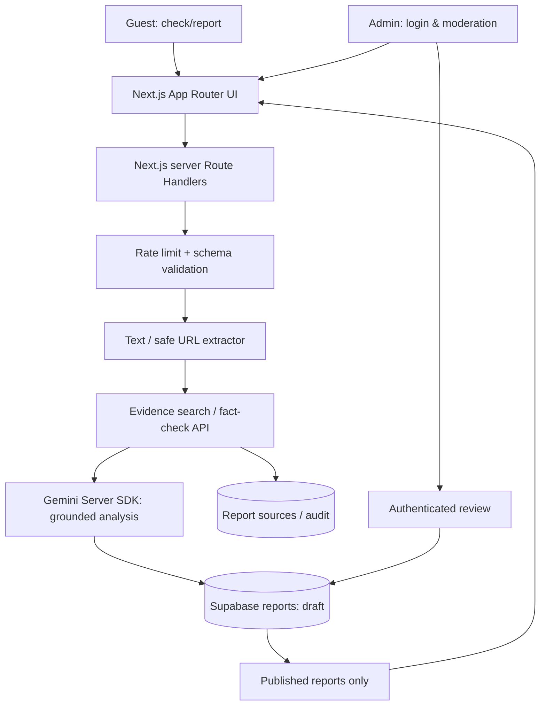

# Architecture — phased, secure & auditable

## Stack
- **Frontend:** Next.js App Router, React, TypeScript; starter CSS. Optional Tailwind if Yudha's design requires.
- **Backend:** Next.js Route Handlers (server boundary); Zod or equivalent input/output schemas.
- **DB/Auth:** Supabase PostgreSQL, RLS, Supabase Auth SSR & admin allowlist.
- **LLM:** Google Gemini via `@google/genai` SDK; model melalui `GEMINI_MODEL`, tanpa fallback diam-diam. Konfigurasi lokal terakhir teruji `gemini-3.5-flash-lite`; periksa akses/kuota lagi pada proyek tujuan.
- **Evidence:** Google Fact Check Tools untuk metadata dan Tavily Search/Extract basic opsional untuk pencarian/teks sumber. Pengambilan langsung memakai safe-fetch DATA-02. Gemini memilih ID kalimat, server mengambil quote literal; hasil otomatis tetap unverified/draft. Grounding Google tidak dipakai untuk crawl/database report. Detail: [DATA-04](22_TAVILY_EVIDENCE.md).
- **Deploy:** Vercel optional + Supabase; never require paid tier for local scaffolding.

## Data flow
Client → rate-limit + validate → normalize text/URL → evidence retrieval with provenance → LLM compares per-claim evidence → structured output (schema strict) → policy validator → draft persistence → admin review → published view.

## Critical choice
**Evidence retrieval is not the same as verdict.** Semantic similarity is for candidate finding only; perform entailment/contradiction + temporal-context verification. No evidence → unverified.

## No keys / offline mode
UI tetap dapat dibuka tanpa credentials. Endpoint check terintegrasi sejak INT-01: konfigurasi/flag yang belum siap menghasilkan 503, bukan mock atau validation-only yang disamarkan sebagai verifikasi. Alur lengkap menyimpan draft/unverified secara atomik; lihat [integrasi](19_CHECK_INTEGRATION.md).

## Resilience & operations
Use request timeouts, retries only for transient errors, idempotency hash for duplicate claim+URL, quotas/usage logs (no raw secrets), cache evidence results, deterministic structured error codes. Consider asynchronous queue only if request time budget requires; do not misrepresent background processing.

## Architecture decisions
`docs/decisions/ADR-001.md`. Refer to `docs/07_SECURITY_PRIVACY.md` for threat model.
