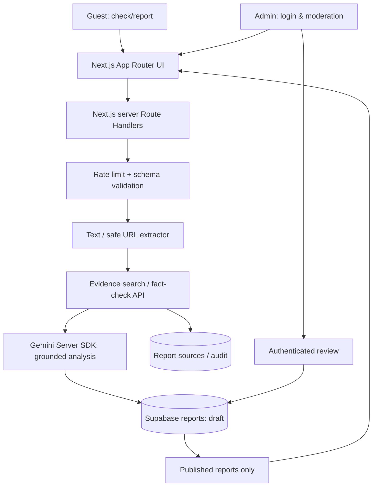

# Architecture — phased, secure & auditable

## Stack
- **Frontend:** Next.js App Router, React, TypeScript; starter CSS. Optional Tailwind if Yudha's design requires.
- **Backend:** Next.js Route Handlers (server boundary); Zod or equivalent input/output schemas.
- **DB/Auth:** Supabase PostgreSQL, RLS, Supabase Auth SSR & admin allowlist.
- **LLM:** Google Gemini via `@google/genai` SDK; `gemini-2.5-flash-lite` as proposed model, availability/limits rechecked at execution.
- **Evidence:** vetted fact-check API or curated DB; Google Fact Check Tools API or permissioned provider; do not scrape blindly.
- **Deploy:** Vercel optional + Supabase; never require paid tier for local scaffolding.

## Data flow
Client → rate-limit + validate → normalize text/URL → evidence retrieval with provenance → LLM compares per-claim evidence → structured output (schema strict) → policy validator → draft persistence → admin review → published view.

## Critical choice
**Evidence retrieval is not the same as verdict.** Semantic similarity is for candidate finding only; perform entailment/contradiction + temporal-context verification. No evidence → unverified.

## No keys / offline mode
Initial scaffold runs without credentials with validation-only endpoint and **no report storage**. Real calls must be enabled deliberately after external setup; no silent mock verdicts.

## Resilience & operations
Use request timeouts, retries only for transient errors, idempotency hash for duplicate claim+URL, quotas/usage logs (no raw secrets), cache evidence results, deterministic structured error codes. Consider asynchronous queue only if request time budget requires; do not misrepresent background processing.

## Architecture decisions
`docs/decisions/ADR-001.md`. Refer to `docs/07_SECURITY_PRIVACY.md` for threat model.
